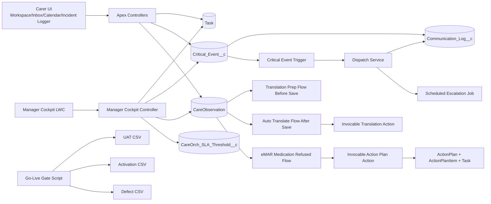

# CareOrch Solution Design Deep Dive

Date: 2026-05-28
Primary Org: careorchdev
Design Baseline: Permission-set-led, declarative-first, mobile-first

## 1. Purpose

This document is the technical onboarding reference for new Salesforce team members joining CareOrch delivery. It explains the complete current design, every moving part, the data and control paths, and how each component contributes to safety, trust, reliability, and operational oversight outcomes.

## 2. Design Principles

1. Declarative first.
2. Permission-set-led access control; no profile-first security model.
3. Hard-stop compliance for critical safety controls.
4. Single-page manager operations where possible (minimal navigation hops).
5. Measurable operations with explicit KPIs and testable gates.

## 3. Architecture Overview

## 4. Capability Modules

## 4.1 Carer Workspace and Shift Experience

### Objective

Give floor carers a focused workspace, shift inbox, and upcoming calendar with shift reliability metrics.

### UI Components

1. Workspace tab/LWC:
- [force-app/main/default/tabs/careOrchCarerWorkspace.tab-meta.xml](force-app/main/default/tabs/careOrchCarerWorkspace.tab-meta.xml)
- [force-app/main/default/lwc/careOrchCarerWorkspace/careOrchCarerWorkspace.js](force-app/main/default/lwc/careOrchCarerWorkspace/careOrchCarerWorkspace.js)

2. Shift Inbox tab/LWC:
- [force-app/main/default/tabs/careOrchShiftInbox.tab-meta.xml](force-app/main/default/tabs/careOrchShiftInbox.tab-meta.xml)
- [force-app/main/default/lwc/careOrchShiftInbox/careOrchShiftInbox.js](force-app/main/default/lwc/careOrchShiftInbox/careOrchShiftInbox.js)

3. Calendar tab/LWC:
- [force-app/main/default/tabs/careOrchMyCalendar.tab-meta.xml](force-app/main/default/tabs/careOrchMyCalendar.tab-meta.xml)
- [force-app/main/default/lwc/careOrchMyCalendar/careOrchMyCalendar.js](force-app/main/default/lwc/careOrchMyCalendar/careOrchMyCalendar.js)

### Server APIs

1. Workspace controller:
- [force-app/main/default/classes/CareOrchCarerWorkspaceController.cls](force-app/main/default/classes/CareOrchCarerWorkspaceController.cls)
- Methods: get open tasks for current user, complete task.

2. Shift inbox controller:
- [force-app/main/default/classes/CareOrchShiftInboxController.cls](force-app/main/default/classes/CareOrchShiftInboxController.cls)
- Method: get current user shift tasks with reliability metrics.

3. Calendar controller:
- [force-app/main/default/classes/CareOrchMyCalendarController.cls](force-app/main/default/classes/CareOrchMyCalendarController.cls)
- Method: get next 14-day shift agenda.

### Shift Routing Core Logic

1. Trigger:
- [force-app/main/default/triggers/CareOrchShiftAssignmentTrigger.trigger](force-app/main/default/triggers/CareOrchShiftAssignmentTrigger.trigger)

2. Service:
- [force-app/main/default/classes/CareOrchShiftAssignmentService.cls](force-app/main/default/classes/CareOrchShiftAssignmentService.cls)
- Responsibilities:
  - Initialize contacted/rejected counters and status defaults.
  - Send assignment emails to current caregiver.
  - Handle reject-and-route to next eligible caregiver.
  - Calculate and update reliability metrics:
    - first response
    - time to fill
    - contacted count
    - rejected count
  - Evaluate at-risk conditions:
    - high rejection streak
    - repeated unfilled shifts by location/time band
  - Notify manager on acceptance, rejection, at-risk, or unfilled outcomes.

3. REST response endpoint for email links:
- [force-app/main/default/classes/CareOrchShiftResponseRest.cls](force-app/main/default/classes/CareOrchShiftResponseRest.cls)
- Endpoint: /services/apexrest/careorch/shift-response?action=accept|reject&taskId=...

### Shift Data Fields (Task/Activity)

Core custom fields are in:
- [force-app/main/default/objects/Activity/fields](force-app/main/default/objects/Activity/fields)

Key fields:
- CareOrch_Shift_Start__c
- CareOrch_Shift_End__c
- CareOrch_Shift_Status__c
- CareOrch_Contacted_Count__c
- CareOrch_Rejected_Count__c
- CareOrch_Time_to_First_Response_Minutes__c
- CareOrch_Time_to_Fill_Minutes__c
- CareOrch_At_Risk__c
- CareOrch_At_Risk_Reason__c
- CareOrch_At_Risk_Alert_Sent__c
- Likely_To_Fail__c alias:
  - [force-app/main/default/objects/Activity/fields/Likely_To_Fail__c.field-meta.xml](force-app/main/default/objects/Activity/fields/Likely_To_Fail__c.field-meta.xml)

## 4.2 Critical Incident and Family Communication Closed Loop

### Objective

Ensure critical incidents are logged in context, family communication is executed and auditable, and SLA escalation is automatic.

### Incident Creation Path

1. Incident logger UI component:
- [force-app/main/default/lwc/careOrchIncidentLogger/careOrchIncidentLogger.js](force-app/main/default/lwc/careOrchIncidentLogger/careOrchIncidentLogger.js)

2. Incident controller:
- [force-app/main/default/classes/CareOrchCriticalIncidentController.cls](force-app/main/default/classes/CareOrchCriticalIncidentController.cls)
- Responsibilities:
  - Resolve active shift for current caregiver.
  - Require incident taxonomy.
  - Create Critical_Event__c with resident and shift context.
  - Persist geolocation from incident capture.

### Dispatch and Escalation Path

1. Trigger:
- [force-app/main/default/triggers/CareOrchCriticalEventTrigger.trigger](force-app/main/default/triggers/CareOrchCriticalEventTrigger.trigger)

2. Dispatch service:
- [force-app/main/default/classes/CareOrchCriticalEventDispatchService.cls](force-app/main/default/classes/CareOrchCriticalEventDispatchService.cls)
- Responsibilities:
  - Create initial Communication_Log__c for primary contact.
  - Send initial family email dispatch.
  - Schedule escalation job based on configured SLA threshold.
  - On escalation (if no acknowledged comms):
    - send secondary backup dispatch
    - notify manager
    - move event to Pending Review.

3. Schedulable job:
- [force-app/main/default/classes/CareOrchCriticalEventEscalationJob.cls](force-app/main/default/classes/CareOrchCriticalEventEscalationJob.cls)

### Golden Rule Hard-Stop Enforcement

A critical event cannot be moved to Closed without acknowledged communication evidence.

1. Validation rule:
- [force-app/main/default/objects/Critical_Event__c/validationRules/CareOrch_Closed_Loop_Acknowledgement.validationRule-meta.xml](force-app/main/default/objects/Critical_Event__c/validationRules/CareOrch_Closed_Loop_Acknowledgement.validationRule-meta.xml)

2. Evidence field (roll-up):
- [force-app/main/default/objects/Critical_Event__c/fields/Acknowledged_Communication_Count__c.field-meta.xml](force-app/main/default/objects/Critical_Event__c/fields/Acknowledged_Communication_Count__c.field-meta.xml)

3. Additional clinical close/pending gate:
- [force-app/main/default/objects/Critical_Event__c/validationRules/CareOrch_Mandatory_Clinical_Doc.validationRule-meta.xml](force-app/main/default/objects/Critical_Event__c/validationRules/CareOrch_Mandatory_Clinical_Doc.validationRule-meta.xml)

## 4.3 Translation and Documentation Quality Controls

### Objective

Control translation lifecycle and documentation quality for multilingual observations.

### Translation Lifecycle

1. Before-save prep flow:
- [force-app/main/default/flows/CareOrch_Observation_Translation_Prep.flow-meta.xml](force-app/main/default/flows/CareOrch_Observation_Translation_Prep.flow-meta.xml)
- Sets translation path to Reviewed or Pending based on language and existing translation values.

2. After-save auto translate flow:
- [force-app/main/default/flows/CareOrch_Observation_Auto_Translate.flow-meta.xml](force-app/main/default/flows/CareOrch_Observation_Auto_Translate.flow-meta.xml)
- Calls invocable action to perform translation.

3. Invocable translation action:
- [force-app/main/default/classes/CareOrchObservationAutoTranslateAction.cls](force-app/main/default/classes/CareOrchObservationAutoTranslateAction.cls)
- Responsibilities:
  - Attempts translation via named credential endpoint callout.
  - Fallback lexical translation rules when provider unavailable.
  - Updates status to Auto-translated and flags Draft_Unverified_Translation__c.
  - Reassigns ownership to translation review queue when available.

4. Reviewer-only status gate:
- [force-app/main/default/objects/CareObservation/validationRules/CareOrch_Reviewed_Status_Admin_Only.validationRule-meta.xml](force-app/main/default/objects/CareObservation/validationRules/CareOrch_Reviewed_Status_Admin_Only.validationRule-meta.xml)

### Clinical Logger

1. Resident clinical logger:
- [force-app/main/default/classes/CareOrchResidentClinicalLogger.cls](force-app/main/default/classes/CareOrchResidentClinicalLogger.cls)
- Builds CareObservation records and sets translation status based on author language.

## 4.4 eMAR Signal to Action Plan Automation

### Objective

Convert medication refusal signals into structured action plans and tasks.

1. REST ingestion endpoint:
- [force-app/main/default/classes/CareOrchEmarSignalsRest.cls](force-app/main/default/classes/CareOrchEmarSignalsRest.cls)
- Endpoint: /services/apexrest/CareOrch/v1/eMARSignals/*
- Validates strict payload keys and resolves resident.

2. Triggering flow for medication refused:
- [force-app/main/default/flows/CareOrch_Medication_Refused_Action_Plan.flow-meta.xml](force-app/main/default/flows/CareOrch_Medication_Refused_Action_Plan.flow-meta.xml)

3. Invocable action and service:
- [force-app/main/default/classes/CareOrchEmarSignalActionPlanAction.cls](force-app/main/default/classes/CareOrchEmarSignalActionPlanAction.cls)
- [force-app/main/default/classes/CareOrchEmarSignalActionPlanService.cls](force-app/main/default/classes/CareOrchEmarSignalActionPlanService.cls)
- Creates ActionPlan, ActionPlanItem, and high-priority Task records from template items.

## 4.5 Manager Cockpit (DASH)

### Objective

Provide a single operational control tower for managers to spot and resolve risk quickly.

### UI and Navigation

1. Manager cockpit LWC:
- [force-app/main/default/lwc/careOrchManagerCockpit/careOrchManagerCockpit.html](force-app/main/default/lwc/careOrchManagerCockpit/careOrchManagerCockpit.html)
- [force-app/main/default/lwc/careOrchManagerCockpit/careOrchManagerCockpit.js](force-app/main/default/lwc/careOrchManagerCockpit/careOrchManagerCockpit.js)

2. Tab:
- [force-app/main/default/tabs/careOrchManagerCockpit.tab-meta.xml](force-app/main/default/tabs/careOrchManagerCockpit.tab-meta.xml)

3. Home flexipage:
- [force-app/main/default/flexipages/Manager_Cockpit.flexipage-meta.xml](force-app/main/default/flexipages/Manager_Cockpit.flexipage-meta.xml)

### Widget Set

1. Critical SLA Breaches
2. At-Risk Shifts
3. Pending Translation Reviews
4. Open Risk Aging Trend and drill-down

### Cockpit Server Logic

1. Controller:
- [force-app/main/default/classes/CareOrchManagerCockpitController.cls](force-app/main/default/classes/CareOrchManagerCockpitController.cls)
- Capabilities:
  - KPI snapshot with trend points.
  - Query and filter rows for each widget.
  - Inline save for critical events, shifts, and translation reviews.
  - Manual phone override logging.
  - In-line shift reassignment with caregiver eligibility check.

### Important UI Behaviors

1. Auto-refresh every 30 seconds.
2. Trend segment click applies day+segment filter to risk aging records.
3. In-line datatable edits call saveRows.
4. Reassign action opens modal and performs server-side reassignment.

## 4.6 SLA Threshold Configuration (GOVERN)

### Objective

Move SLA thresholds from hardcoded constants to configurable governance data.

1. SLA threshold object:
- [force-app/main/default/objects/CareOrch_SLA_Threshold__c/CareOrch_SLA_Threshold__c.object-meta.xml](force-app/main/default/objects/CareOrch_SLA_Threshold__c/CareOrch_SLA_Threshold__c.object-meta.xml)

2. Fields:
- Event_Category__c
- Threshold_Minutes__c
- Active__c

3. Threshold resolver service:
- [force-app/main/default/classes/CareOrchSlaThresholdService.cls](force-app/main/default/classes/CareOrchSlaThresholdService.cls)
- Behavior:
  - resolve by category key
  - fallback to DEFAULT
  - fallback constants (Death=15, Default=30)

4. Runtime dependencies:
- [force-app/main/default/classes/CareOrchCriticalEventDispatchService.cls](force-app/main/default/classes/CareOrchCriticalEventDispatchService.cls)
- [force-app/main/default/classes/CareOrchManagerCockpitController.cls](force-app/main/default/classes/CareOrchManagerCockpitController.cls)
- [force-app/main/default/lwc/careOrchManagerCockpit/careOrchManagerCockpit.js](force-app/main/default/lwc/careOrchManagerCockpit/careOrchManagerCockpit.js)

## 4.7 Security and Persona Model (GOVERN)

### CareOrch Application Shell

- [force-app/main/default/applications/CareOrch.app-meta.xml](force-app/main/default/applications/CareOrch.app-meta.xml)

### Persona Permission Sets

1. Floor Carer:
- [force-app/main/default/permissionsets/CareOrch_Floor_Carer.permissionset-meta.xml](force-app/main/default/permissionsets/CareOrch_Floor_Carer.permissionset-meta.xml)
- Broad operational use for shift execution, incident logging, and observation updates.

2. Clinical Workspace Reviewer:
- [force-app/main/default/permissionsets/CareOrch_Clinical_Workspace.permissionset-meta.xml](force-app/main/default/permissionsets/CareOrch_Clinical_Workspace.permissionset-meta.xml)
- Translation and clinical operational edits with cockpit tab non-default availability.

3. Operations Lead:
- [force-app/main/default/permissionsets/CareOrch_Operations_Lead.permissionset-meta.xml](force-app/main/default/permissionsets/CareOrch_Operations_Lead.permissionset-meta.xml)
- Global read/write on cockpit governance objects and RunReports access.

4. Runtime case access support:
- [force-app/main/default/permissionsets/CareOrch_Case_Runtime_Access.permissionset-meta.xml](force-app/main/default/permissionsets/CareOrch_Case_Runtime_Access.permissionset-meta.xml)

### Access Notes

1. This org accepts tab visibility values Visible and Available in permission set metadata.
2. Cockpit exposure is persona-driven through permission set tab settings.
3. New operational access should be granted via permission sets only.

## 4.8 UAT and Production Go-Live Gate Automation

### Objective

Prevent promotion when quality, adoption, or defect controls are below threshold.

1. Gate script:
- [scripts/careorch_go_live_gate.ps1](scripts/careorch_go_live_gate.ps1)

2. Gate documentation:
- [scripts/careorch_go_live_gate_README.md](scripts/careorch_go_live_gate_README.md)

3. Input templates:
- [scripts/careorch_uat_journey_summary_template.csv](scripts/careorch_uat_journey_summary_template.csv)
- [scripts/careorch_activation_audit_template.csv](scripts/careorch_activation_audit_template.csv)
- [scripts/careorch_defect_export_template.csv](scripts/careorch_defect_export_template.csv)

### Gate Conditions

1. Journey pass rate >= 95%.
2. Crash count == 0.
3. Activation baseline >= 80% of pilot users with interactive activity.
4. Unresolved High/Critical defects == 0 for SLA timers, validation rules, profile security.

## 5. Data Model Inventory (Core CareOrch Objects)

1. Critical_Event__c
- Incident lifecycle, category, shift context, location, and communication evidence linkage.

2. Communication_Log__c
- Outbound communication attempts, channel, status, acknowledgment.

3. CareObservation
- Clinical observation values, translation status/lifecycle, source and reviewer workflow.

4. Task (Activity)
- Shift assignment lifecycle, reliability metrics, and operational routing state.

5. CareOrch_SLA_Threshold__c
- Category-level SLA minute configuration and activation flag.

6. ActionPlan / ActionPlanItem
- Structured follow-up for medication refused signals.

## 6. Automated Test Coverage (Current)

Primary CareOrch tests include:

1. [force-app/main/default/classes/CareOrchCriticalEventWorkflowTest.cls](force-app/main/default/classes/CareOrchCriticalEventWorkflowTest.cls)
- dispatch creation
- escalation behavior
- Golden Rule close-block enforcement

2. [force-app/main/default/classes/CareOrchManagerCockpitControllerTest.cls](force-app/main/default/classes/CareOrchManagerCockpitControllerTest.cls)
- snapshot and trend
- inline updates
- phone override logging

3. [force-app/main/default/classes/CareOrchShiftReliabilityTest.cls](force-app/main/default/classes/CareOrchShiftReliabilityTest.cls)
- shift routing/reliability behavior

4. [force-app/main/default/classes/CareOrchObsAutoTranslateTest.cls](force-app/main/default/classes/CareOrchObsAutoTranslateTest.cls)
- translation automation path

5. [force-app/main/default/classes/CareOrchEmarSignalsRestTest.cls](force-app/main/default/classes/CareOrchEmarSignalsRestTest.cls)
- eMAR ingestion path

6. [force-app/main/default/classes/CareOrchCarerWorkspaceControllerTest.cls](force-app/main/default/classes/CareOrchCarerWorkspaceControllerTest.cls)

7. [force-app/main/default/classes/CareOrchResidentProfileTest.cls](force-app/main/default/classes/CareOrchResidentProfileTest.cls)

## 7. Known Operational Constraints

1. Flexipage template tokens are org-sensitive; use retrieved valid templates for deploy-safe page metadata.
2. Permission set metadata has strict enum and dependency parsing; update incrementally and validate in org.
3. Restricted picklists in this org can cause test/setup failures if non-allowed values are used.

## 8. Recommended Onboarding Walkthrough (New Team Member)

1. Read this document start-to-end.
2. Open CareOrch app metadata and tabs first.
3. Review triggers and core services in this order:
- shift trigger/service/rest
- critical event trigger/dispatch/escalation
- translation flows and invocable action
- cockpit controller and LWC
4. Review persona permission sets.
5. Run core test classes.
6. Execute go-live gate script with sample templates.

## 9. Traceability to Delivery Plan

The implementation aligns with:
- [docs/careorch-standout-6-week-delivery-plan.md](docs/careorch-standout-6-week-delivery-plan.md)

Key covered outcomes:
1. closed-loop family communication with hard-stop controls,
2. shift reliability metrics and at-risk routing,
3. translation review and documentation gates,
4. manager cockpit with in-line corrective actions,
5. governance via persona security and release gate checks.
